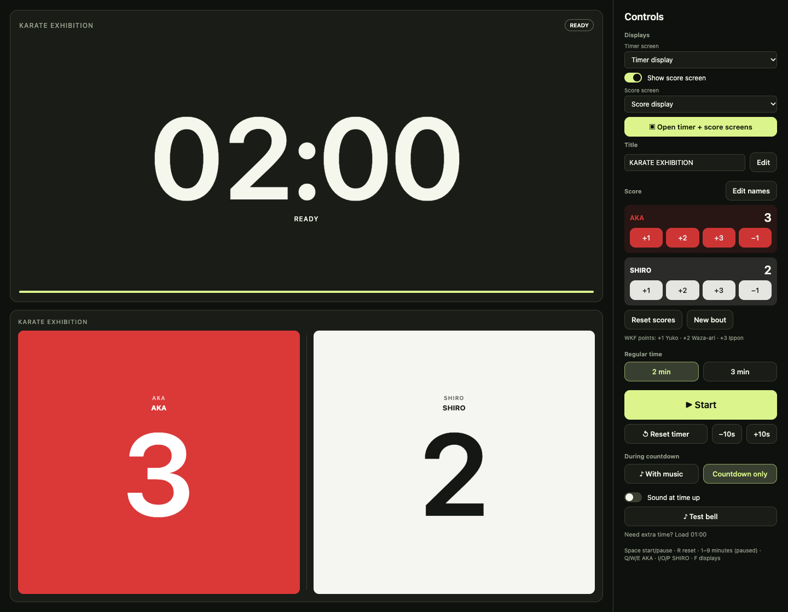
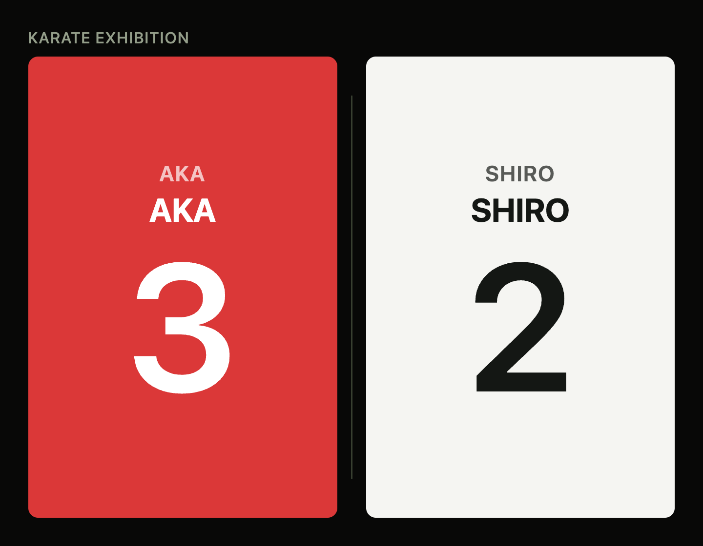
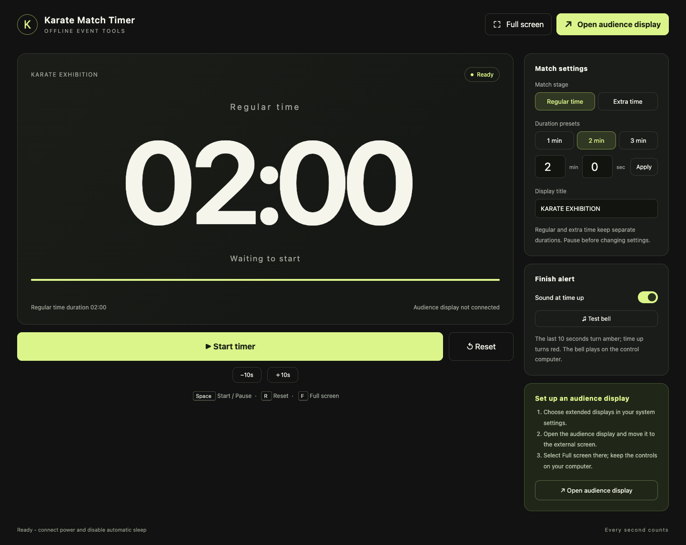

# Karate Match Timer

Offline timing and score displays for community karate events. An operator controls the match on one screen while participants and spectators see a large countdown and, in the desktop versions, a separate AKA / SHIRO scoreboard.

## Built for a real community event

I built this tool for a non-profit karate community in Auckland that offers free participation. I train with the group weekly and volunteered to provide the software and on-site technical support for its first exhibition event on **10 October 2026**. I also helped write participants' names on their certificates.

After seeing the program, the instructor requested a copy and said it would be used at future events. The exhibition is the first confirmed use; future use is planned.

## Choose a version

| Version | What it provides | Run or build |
| --- | --- | --- |
| [macOS](macos/) | Native SwiftUI/AppKit controls, timer display and scoreboard | [macOS guide](macos/README.md) |
| [Windows](windows/) | Electron controls, timer display, scoreboard and optional local music | [Windows guide](windows/README.md) |
| [Browser](web/) | Earlier timer-only version with a separate audience window | Open `web/index.html` after downloading the repository |

All versions work offline and store match state locally. No account or server is required. The browser version does **not** include the desktop scoreboard or music controls.



*The desktop renderer, shown with sample event settings and scores.*

<details>
<summary>Audience scoreboard and browser timer</summary>





</details>

## Match-day features

- Start, pause, resume, reset and adjust the remaining time.
- Configure regular and extra-time durations; defaults are editable event settings.
- Keep operator controls separate from the audience display.
- Use large time digits, a final-ten-seconds warning and an optional finish bell.
- In the desktop versions, add or correct AKA / SHIRO points and select separate timer and score screens.
- Recover saved match state in a paused condition so the operator can check it before resuming.

See the [operator guide](docs/operator-guide.md) for setup and the [engineering notes](docs/architecture.md) for timing, recovery and display behaviour.

## Repository structure

```text
macos/       Native application, timer core, Swift tests and app build scripts
windows/     Electron application, renderer, Node tests and packaging configuration
web/         Offline browser timer: HTML, CSS and JavaScript
docs/       Operator guide, engineering notes and screenshots
.github/     Automated checks
```

Source files and tests are organised by platform. Build output, local preferences, participant data, caches and personal music files are excluded from version control. The original event folder is retained separately.

## Development checks

```sh
# From the repository root; these tests use Node's built-in test runner.
node --test windows/test/*.test.js

# On macOS with Swift 5.9 or later.
cd macos
swift test
```

The countdown tests cover delayed refreshes, pause/resume, completion, bounds and recovery. Desktop JavaScript tests also cover scoring, window control and optional music. GitHub Actions runs the Node and Swift suites.

## Scope

The program assists a human timekeeper and scorekeeper. It does not adjudicate points or encode a complete competition ruleset. The desktop point buttons use +1 / +2 / +3 labels; the event organisers determine how they are used. Display routing, speaker volume and competition settings should be checked on the event equipment.
